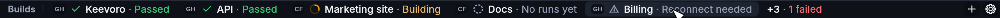

# BuildRail

BuildRail is a thin strip along the bottom of your screen that tells you, at a glance, whether the builds you care about are passing. Pin a GitHub Actions workflow or a Cloudflare Worker, and its entry stays in the same place all day, so you learn where to look.



It talks to GitHub and Cloudflare directly with a read-only token that you supply. There is no BuildRail account and no BuildRail server.

## What the strip shows

Each entry is the provider, your short label, a status icon and a status word.

| Colour | Meaning |
|---|---|
| Green | Passed, or deployment confirmed |
| Amber | Queued or building |
| Red | Failed |
| Neutral | Cancelled, skipped or unavailable (each has its own word and icon) |

Hover over an entry, or move to it with Tab or the arrow keys, to see the branch, commit, age and failing job. Click it, or press Enter, to open the run on the provider's site. When the strip is too narrow, the entries that do not fit collapse into an overflow marker that shows how many of them are failing.

If the network drops, the strip keeps showing the last known result with its age, and marks it as offline. It refreshes immediately when the machine wakes or you reconnect.

## Try it without any accounts

Demo mode runs the real interface against made-up builds. It needs no network, no tokens and no keyring.

```bash
cargo run -p buildrail-app -- --demo
```

## Running it for real

```bash
cargo run --release -p buildrail-app
```

On first launch you see **Add build**. The wizard asks you to choose a provider, paste a token, pick the target, check the latest matching run, and give it a short label.

### Tokens

Create a token with read access only. BuildRail stores it in the operating system's credential store (Windows Credential Manager, macOS Keychain, or the Secret Service on Linux) and never writes it to a file, a log or an export.

| Provider | Token type | Permissions |
|---|---|---|
| GitHub | Fine-grained personal access token | Actions: Read, Metadata: Read |
| Cloudflare | User API token (account-owned tokens are rejected by the Builds API) | Workers CI: Read, Workers Scripts: Read |

### Sharing a setup with a teammate

Settings can export your pinned builds as a TOML file. The file holds targets, labels and order, and it has no field that could hold a token.

Your teammate imports it, sees a preview of what will change, and maps each connection name in the file to one of their own connections (or creates one on the spot). Nothing is written until the whole import validates, and the save is atomic, so a broken file cannot damage a working configuration.

```toml
version = 1

[[watch]]
id = "4f6c1a52-93d3-4bd5-8f0e-6f7c1b2a9e10"
label = "API CI"
provider = "github"
connection = "work-github"
owner = "acme"
repo = "api"
workflow = "ci.yml"
branch = "main"            # optional

[[watch]]
id = "marketing-site"
label = "Marketing site"
provider = "cloudflare"
connection = "acme-cf"
account_id = "0123456789abcdef0123456789abcdef"
worker = "marketing-site"
```

Monitor, scale, theme, placement and start-at-login are kept in a separate per-device file and are never exported.

## How it behaves on each system

| System | Placement | State of testing |
|---|---|---|
| Windows | Registers as an AppBar, so it sits above the taskbar and maximised windows stop short of it | Type-checked only. Never run. |
| Linux, X11 | Sets dock type and struts, so the window manager reserves the edge | Docking tested against a real X server (Xvfb), not against a real window manager |
| Linux, Wayland | Compact movable window. A winit window cannot become a layer-shell surface yet. | Not run |
| macOS | Compact movable window. macOS has no public way to reserve a screen edge. | Type-checked only. Never run. |

The strip hides while a fullscreen app is on its monitor (Windows and X11), never takes keyboard focus on its own, and follows the system light or dark theme unless you override it.

> **Before you rely on it:** the real window has not been opened on any operating system yet. Everything above the window layer is tested, and the strip is rendered and checked headlessly, but the first job on each system is to run `--demo` and then the acceptance scenario below.

## Finding your way around the code

The workspace is five crates. The rule is that knowledge flows one way: everything depends on `buildrail-core`, and `buildrail-core` depends on nothing else in the workspace.

| Crate | What lives there | Start reading at |
|---|---|---|
| `buildrail-core` | The vocabulary (watch, build record, status), the traits the outside world implements, which run wins, and when to poll | `src/domain.rs`, then `src/ports.rs` |
| `buildrail-profile` | The TOML profile, the one validation path shared by the picker and the importer, import preview, atomic saves, per-device preferences | `src/lib.rs` (written as a guide) |
| `buildrail-providers` | GitHub and Cloudflare adapters, and the lists the picker needs | `src/github/runs.rs`, `src/cloudflare/status.rs` |
| `buildrail-platform` | Credential store, edge docking per OS, fullscreen detection, opening URLs, start at login | `src/dock/mod.rs` |
| `buildrail-app` | The egui interface and the single place where real adapters are chosen | `src/compose.rs`, then `src/presentation/` |

A few things are worth knowing before you change anything.

- **The interface is deliberately thin.** What an entry says, the wizard steps, import, and docking decisions are plain state machines with no egui in them, which is why they can be tested without a window. If you find yourself putting a decision inside a widget, it probably belongs in `presentation`, `settings` or `shell`.
- **Adding a provider** means implementing `RunSource` and registering it. The refresh engine does not change.
- **An older run can never replace a newer one.** That rule lives in `buildrail-core/src/selection.rs` and nowhere else.
- **Polling** is 60 seconds when idle and 15 seconds while a build is active. Watches that point at the same target share one request. Failures back off from 30 seconds up to 10 minutes, and a rate limit pauses every request on that connection.

### Cloudflare details to confirm

The Cloudflare adapter was written from the API specification without access to a live account. Each unconfirmed detail sits in one small tested function, so correcting it is a one-line change.

- When a successful build counts as "Deployed" rather than "Passed" (`cloudflare/status.rs`, `is_production_deploy`).
- The dashboard link format for a build (`dashboard_build_url`).
- Whether a Worker that is not connected to Builds answers with "not found" or an empty list.
- Which Cloudflare error codes mean "access denied" (`CLOUDFLARE_AUTH_ERROR_CODES` in `http.rs`).
- That a `terminated` build should show as Failed.

## Building and testing

You need Rust 1.95 or newer. No system packages are needed to build. On Linux the window needs `libxkbcommon-x11` at run time, and token storage needs a running Secret Service such as GNOME Keyring or KWallet.

```bash
cargo test --workspace
```

On Linux the docking tests want a display. Without one they skip; to run them headlessly:

```bash
xvfb-run -a cargo test --workspace
```

Coverage, which CI holds at 90% of lines or better:

```bash
xvfb-run -a cargo llvm-cov --workspace --summary-only
```

Lint, with warnings treated as errors:

```bash
cargo clippy --workspace --all-targets -- -D warnings
```

Set `BUILDRAIL_CONFIG_DIR` to point the app at a scratch folder, so you can experiment without touching your real configuration.

## Releasing

The Release workflow builds the Windows executable.

- **To try a build without releasing**, open the Actions tab, choose Release, and press "Run workflow". The zip is attached to the run as an artifact.
- **To publish a release**, set the version in the root `Cargo.toml`, merge, then create a matching tag. The workflow refuses a tag that does not match the version. You can create the tag either way:
    - On GitHub: Releases, "Draft a new release", type the tag (for example `v0.1.0`), target `main`, and publish. The workflow attaches the zip a few minutes later.
    - From a clone, with the two commands below.

```bash
git tag v0.1.0
```

```bash
git push origin v0.1.0
```

The release gets a zip containing `buildrail.exe`, a `Try the demo.cmd` you can double-click to see the strip with made-up builds, and this README, plus a SHA-256 checksum. The exe is not code-signed, so Windows SmartScreen will warn the first time it runs.

## Acceptance checklist for each operating system

These are the checks that cannot be automated here and need a person at a real desktop.

1. Run `--demo`. Confirm the strip is 24 pixels tall at your display scale, sits where the table above says, and does not take focus from the app you were typing in.
2. Maximise a window and confirm it stops above the strip (Windows and X11).
3. Open a fullscreen app and confirm the strip gets out of the way.
4. Pin a GitHub workflow and a Worker, trigger builds, and watch queued, building and the final state appear. Open each run from the strip.
5. Re-run a build and confirm the entries do not change order.
6. Disconnect the network and confirm the entries show their age and an offline note. Sleep and wake the machine and confirm they recover.
7. Export the profile, import it on a second operating system, and confirm the same targets in the same order after you supply local tokens.
8. Import a deliberately broken file and confirm your configuration is untouched.

## Not in this release

- A hosted team service. Sharing a profile file covers teams whose members already have provider access.
- Sign-in through the browser. Connecting is by pasted token; the code has a seam for a device flow.
- Reserving a screen edge on Wayland and macOS.
- A native file picker for import. You type or paste the path.
